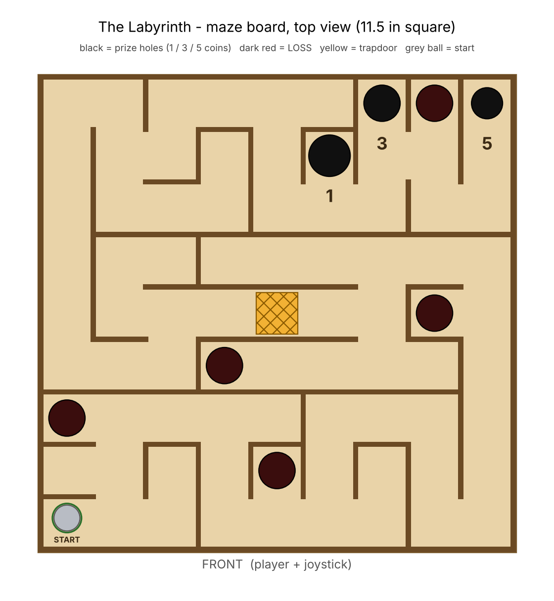
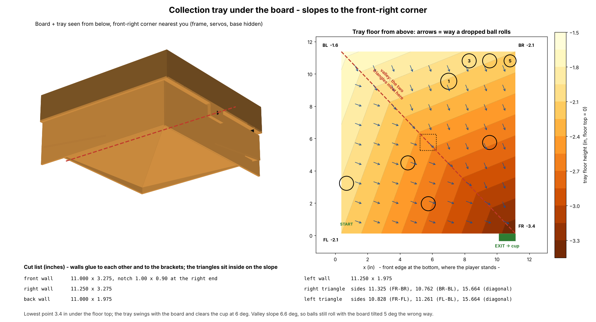

# The Labyrinth: maze board (GE1501 Group 1)

Draftsperson files for the tilting ball maze. Everything here comes from
`make_labyrinth.py`. Edit the maze or a setting at the top of the script and
re-run `python3 make_labyrinth.py`.

| File | Use it for |
|---|---|
| `Labyrinth_Board.dxf` | Open in AutoCAD. Laser layout, 1:1, inches, layers already set up |
| `Labyrinth_Template_Letter.pdf` | **Milestone 2 cardboard prototype.** Page 1 has instructions + cut list; pages A1–B2 are the floor at 1:1 on 4 letter sheets |
| `Labyrinth_Template_FullSize.pdf` | Same floor on one 13 × 13 in page (plotter / large printer) |
| `Labyrinth_board_top.png` | Top view of the finished board (slides, report) |
| `Labyrinth_preview.png` | Picture of the DXF: sheet 1 + sheet 2 |
| `Labyrinth_3D.scr` | AutoCAD script: in a new drawing type `SCRIPT` and pick it to build the whole game in 3D: board, frame, axis holes, servo cutouts, posts, base (`make_autocad_script.py` rebuilds it) |
| `Labyrinth_tray.png` | The collection tray under the board: heights, which way a dropped ball rolls, cut list (`make_tray_views.py` rebuilds it) |
| `Labyrinth_animate.lsp` | AutoCAD animation: load it with `APPLOAD` in the drawing built by `Labyrinth_3D.scr`, then type `TILTDEMO` |
| `Labyrinth_axis1_bracket.png` | Close-up from below of the axis-1 brackets under the board (servo 1 on the left, pin on the right) |
| `Labyrinth_axes_explained.png` | Four pictures of how the two axes move, coloured by what moves with what (`make_axis_views.py` rebuilds it from the 3D model) |
| `Labyrinth_two_axis.mp4` | 20 s video of the same (`make_axis_views.py --video`) |
| `pico/servo_test.py` | Bench test for one servo: centre, sweep, step response, smallest visible step |
| `pico/joystick_servos.py` | Joystick drives both servos, with deadzone, expo, smoothing and a level button: the start of the real control loop |

## The design numbers

| Item | Value | Why |
|---|---|---|
| Floor plate | 11.5 × 11.5 in | The laser bed is 12 × 16 in and the guide asks for a ¼ in border, so 11.5 in is the biggest square that fits. Change `BOARD` if the frame has to fit inside 12 × 12 |
| Ball | ⅝ in steel ball bearing | Heavy, so it rolls smoothly and the same way every time. 3D-printed balls are light and slightly rough |
| Grid | 9 × 9 cells, 1.264 in apart | Corridor is 1.139 in between walls, about 1.8 balls wide |
| Walls / rim | ⅛ in ply, 2 in tall / 2 in tall (blue frame level with the rim, servo bay lower) | Team choice. The ball can never hop a wall. Tall walls hide the ball from low angles, so check the view in the cardboard prototype |
| **5 coin** hole | ¾ in drill | Smallest, at the far corner (back-right) |
| **3 coin** hole | ⅞ in drill | Side pocket just before the 5 |
| **1 coin** hole | 1 in drill | Side pocket before that, easiest to sink |
| LOSS holes (×5) | ⅞ in drill | Dead-end pockets and side pits along the route |
| Trapdoor | 1 in square, separate flap | On the only route, in the middle of a 6-cell straight. Its servo hangs under the board centre, which barely moves when the board tilts |

All hole sizes are standard Forstner bit sizes, so the drill press makes
them exactly. The route from START to the 5 is about 54 cells long. Every
cell is reachable, and there is exactly one way through. The script checks
both every time it runs.

**Why START is a ring, not a divot.** A ball sitting in a hole only rolls
out once the board tilts more than asin(hole ÷ ball). A ⅜ in divot under a ⅝
in ball needs 37° of tilt to escape, and this board only tilts about 6°. The
start is instead a dead-end pocket with a thin engraved ring. The ball stays
put while the board is level. If you really want a detent, a 1/16 in hole
releases the ball at about 6°. Test that in cardboard first.

## Collection tray

Every ball that drops through a hole (prize holes, loss holes, the
trapdoor) lands in a tray hung under the floor. The tray moves with the
board. Its floor is two flat triangles that meet on the diagonal from the
back-left corner down to the **front-right corner** (the corner in line
with START's row and the 5 hole's column), so the ball rolls to that
corner and out a 1 in notch in the front wall into a cup on the base.
A triangle is always flat, so it works in stiff wood as well as cardboard.

- Floor heights (below the floor top): back-left 1.6 in, front-left and
  back-right 2.1 in, front-right 3.4 in. The valley slopes 6.6 deg, so a
  ball still rolls with the board tilted 5 deg the wrong way.
- The side walls sit just inside the axis-1 brackets and glue to them;
  wall tops stop 1/4 in under the floor so they clear the bracket flanges.
- The base sits 1 in lower than before (top at -5.5 in) so the tray
  clears the cup at 6 deg on both axes. The script checks this, the
  trapdoor flap's swing, and that every hole is over the tray.
- Cut list: run `python3 make_tray_views.py`, or see `Labyrinth_tray.png`.

## Milestone 2: cardboard prototype (no laser yet)

1. Print `Labyrinth_Template_Letter.pdf` at **100% / Actual size**. Check
   that the 2 in square measures 2.000 in. Tape the four quarter pages
   together on the dashed centre lines.
2. Floor material: flatness matters more than strength. A warped floor makes
   the ball roll on its own. Good choices are chipboard/matboard, foam board,
   or two layers of corrugated glued with the flutes crossing.
3. Glue the template on with a glue stick or spray mount and let it dry flat.
4. Drill the holes on the drill press with the same bits you'll use in
   Milestone 3. Clamp the board on scrap wood and put the bit point on the
   crosshair. This doubles as practice for the auxiliary-tool part.
5. Cut wall and rim strips 2 in tall to the lengths in the cut list (page 1). Each
   strip has a letter (A–J) that matches the shaded footprint on the
   template. Hot glue them on.
6. Trapdoor: cut out the hatched square, cut the flap from the same board,
   and tape or glue it to a micro servo horn underneath.

During playtests, log every play: start, which hole it ended in, coins
paid. That data goes in the M2 report and tells us whether to enlarge or
shrink holes.

## AutoCAD

### Which workspace

Use **Drafting & Annotation**. Click the gear icon on the status bar
(bottom right) → *Drafting & Annotation*. Laser cutters only use flat 2D
lines, so you never need *3D Modeling*. You'll work mostly on the **Home**
ribbon tab (Draw, Modify, Layers panels).

### Open this drawing

`OPEN` → set *Files of type* to **DXF** → `Labyrinth_Board.dxf`, then
`SAVEAS` a `.dwg`. The drawing is in inches at 1:1. Type `UNITS` to confirm:
Decimal, 0.000, Inches. If you ever start your own drawing, pick the
**acad.dwt** template (inches), not acadiso.dwt (mm).

### Layers (already in the file)

| Layer | Colour | Laser does | Contents |
|---|---|---|---|
| `CUT` | red, 0.00 mm lineweight | cuts through | floor outline, trapdoor opening, every strip, flap |
| `ENGRAVE` | blue | engraves the outline on the surface | wall footprints (where to glue), drill rings + crosshairs, start ring |
| `RASTER` | black | rasters (filled-in engraving) | START, 1, 3, 5, and "THE LABYRINTH" on the front rim |
| `REFERENCE` | grey, **plot off** | nothing | sheet outlines, piece letters, drill sizes, notes |

Before drawing anything, set the current layer: Layers panel dropdown, or
`LAYER`. To move something to another layer, select it and press
`Ctrl+1` → Layer.

### Commands you'll actually use

| Type | Does |
|---|---|
| `F8` / `F3` | ORTHO (straight lines) / OSNAP (snap to ends, midpoints, centres). Keep both on |
| `L` (LINE), `REC` (RECTANG) | lines, rectangles. Type `@2,0` to go 2 in right of the last point |
| `C` (CIRCLE) | **asks for a radius.** Type `D` first to enter a diameter (`D` → `0.875`) |
| `O` (OFFSET) | copy a line a set distance away, e.g. 0.125 for a wall's other face |
| `TR` (TRIM), `EX` (EXTEND), `F` (FILLET, radius 0) | clean up corners |
| `M` (MOVE), `CO` (COPY), `MI` (MIRROR), `RO` (ROTATE) | with base point + typed distance, e.g. `M` → pick → `@1.2639,0` moves one cell right |
| `AR` (ARRAY) | repeat holes or lines on a grid |
| `DI` (DIST), `LI` (LIST) | measure / inspect before you send anything |
| `J` (JOIN) | glue segments into one closed outline (the laser needs closed shapes) |
| `OVERKILL` | deletes duplicate lines (a doubled line gets cut twice and burns) |

**Example: add a LOSS hole.** Set layer `ENGRAVE` current. `C`, then click the
cell centre (OSNAP *Midpoint* of the two wall faces, or type its
coordinates), then `D`, then `0.875`. Draw the crosshair with `L`.

**Example: move a wall one cell.** Select its footprint rectangle, then
`M`, pick a corner, and type `@0,1.2639`.

**Two ways to change the maze.** Small tweaks are easiest in AutoCAD. Big
maze changes are faster in the `MAZE` text block in `make_labyrinth.py`: `|`
and `---` are walls, `S 1 3 5 X T` are features. Re-running the script
rebuilds the walls, cut list, sheets and templates. It **overwrites** the
DXF, so do AutoCAD-only edits in your `.dwg` copy once the maze is final.

### Sending it to the laser (Milestone 3)

1. Ask FYELIC: bed size, sheet size sold at the bookstore, which file they
   want (DWG / DXF / PDF), what colours mean cut vs. engrave vs. raster (ours: red / blue / black), and their
   kerf. The 12 × 16 bed here comes from a 2018 FYE guide.
2. Measure your plywood with calipers. "⅛ in" laser ply is often 3 mm
   (0.118 in). Put the real number in `T`, re-run, and the walls and
   footprints adjust.
3. Keep rastering on the floor light (fast, low power). A deep raster
   pocket can trap the ball, the same way a divot would.
4. Run `OVERKILL`, then check the CUT layer: closed shapes only, nothing
   outside the dashed ¼ in border.
5. Send one sheet per job: `PLOT` → Plot area **Window** → click two opposite
   corners of that sheet's rectangle → scale **1:1**, with **Fit to paper
   unchecked**. Fit to paper silently rescales everything.
6. Budget: with 2 in walls and rim the board alone needs **3 sheets**
   (the class allows about 2), before the frame, brackets and posts. Ask
   for an extra sheet, or cut the tall walls from another material.
   Laser-cut holes come out about one kerf larger; drilled holes come out
   exactly the bit size.

### Drill press (our auxiliary tool)

Drill the holes **after** laser cutting and **before** gluing walls. Clamp
the floor face-up on scrap wood and put the Forstner bit's centre point on
the engraved crosshair. The engraved ring marks where the hole's edge should
land. Lower the bit until it just touches: if the bit's rim doesn't line up
with the ring, re-centre before cutting through.

## Professor's concerns: input delay and fine control

Most of the fix is mechanical, which means it's in our drawings.

**1. Gear the servo down with the pushrod.** If the servo turns the board
directly, ±6° of board tilt uses only ±6° of a 270° servo. That's only a
few dozen distinct positions, so the board moves in jerky steps. With a linkage,
the servo swings much further than the board:

`board tilt ≈ (horn radius ÷ pushrod distance from pivot) × servo swing`

| Horn hole radius | Pushrod attach point from pivot | Servo swing | Board tilt |
|---|---|---|---|
| 0.5 in | 2.4 in | ±30° | ±6° |
| 0.5 in | 3.4 in | ±45° | ±6° |
| 0.75 in | 3.6 in | ±30° | ±6° |

Aim for ±5–6° of tilt. That's plenty: at 6° the ball crosses a cell in about
0.3 s from rest. More tilt makes it uncontrollable.

**2. Put the pivots through the board's centre of mass.** The plywood
board, walls and rim weigh about 0.3 kg. Balanced on its pivots, the servo
only fights friction. Even 1 cm off-centre needs about 0.3 kg·cm out of the
servo's 25 kg·cm, so **plywood is fine and cardboard isn't needed to save
the servos.**

**3. Kill the slop.** Loose pivots and pushrod ends feel exactly like input
lag. Size pivot holes to the pin or screw, use washers, and use ball links
or tight Z-bends on the pushrods.

**4. Decouple the two axes.** Attach the inner board's pushrod on the outer
frame's pivot line. Then tilting the frame doesn't drag the inner board's
angle with it.

For the electronics side (Benny):
- Keep the loop around 10–20 ms. Don't put `sleep(0.1)` or longer in it.
- Use only light smoothing plus a small deadzone at joystick centre. Heavy
  averaging is what makes control feel laggy.
- Map stick position directly to board angle, capped at ±6°.
- Power the servos from VBUS (USB 5 V), never 3V3. A balanced board on a
  geared-down linkage keeps their current low. A 25 kg servo straining
  against a jam can pull far more than USB gives, so make sure nothing
  binds.
- Run the joystick from **3V3**, not 5 V. The Pico's ADC pins max out at
  3.3 V.
- Worth trying: two knobs (potentiometers), like the classic wooden
  labyrinth. A knob turns 270°; a thumbstick moves about 1 cm. That makes
  fine control much easier.

## Bench test the servos (before building anything)

1. Open the Pico in Thonny (*Tools → Options → Interpreter → MicroPython
   (Raspberry Pi Pico)*). Open `pico/servo_test.py` and press F5. Wiring is
   is in the top of each file. With USB power only, each servo runs from
   **VBUS (pin 40)**, which is the USB 5 V, and GND. Never use 3V3.
   Test one unloaded servo at a time. If the Pico resets or Thonny
   disconnects when a servo moves, the USB port is running out of current.
   Try another port (a USB 3 / USB-C port usually gives more). If your kit
   has an electrolytic capacitor of 100 µF or more, put it across the servo
   power: long leg to VBUS, striped side to GND. Run one servo at a time
   until the other one moves without trouble.
2. Do step 1 of the test (centre) **before** pushing a horn on. Every servo
   is then mounted with its horn at the same middle position.
3. Write down the smallest step you could see in step 4. That number, plus
   the linkage table above, is your answer to the professor's
   fine-control question.
4. Then run `pico/joystick_servos.py` with both servos. Tune `SWING`,
   `EXPO`, `SMOOTH` and `TRIM_X/Y` once they're on the cardboard board.

## Still to decide

- Confirm bed size, sheet size, file type and colours with FYELIC.
- Ball choice. A different ball means new `HOLE_D` values and maybe a
  different `N`.
- Frame/gimbal drawing: posts, outer frame, pivot hardware, pushrod points
  (next drawing; it has to fit in the free part of sheet 2).
- Space under the 3 prize holes (back-right corner) for Filippo's sensors
  and a ball-return chute.
- Trapdoor timing, e.g. bridge up for 3 s, open for 2 s. Keep it
  predictable so the game stays clearly winnable.

Sources: Northeastern FYE
[laser cutting best practices](https://ece.northeastern.edu/wp-content/uploads/pdfs/coe/students/lasercuttingbestpractices.pdf)
(12 × 16 in bed, CUT layer at 0.00 mm, ⅛ in material) and the Northeastern
Makerspaces guide
[Laser cutting right from AutoCAD](https://makerspaces.northeastern.edu/wp-content/uploads/2023/07/Laser-Cutting-from-AutoCAD.docx).
